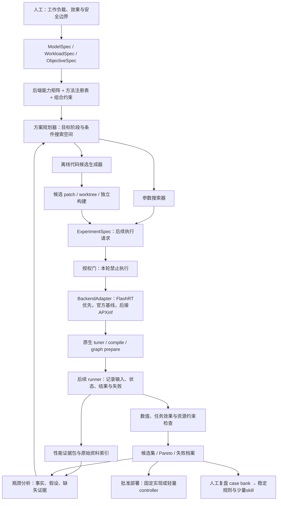

# 性能证据驱动的 VLA 自动调优：机制调研、总体架构与任务划分

**核心建议：以现有 `dev/probeflow` 为开发主线，先建立可信的工作负载、证据和候选接口，再扩展优化方法。** 原生调优器负责既定空间内的数值选择；离线智能体负责诊断、扩展搜索空间和必要的源码修改；机器人在线路径只执行已批准的轻量策略。保留受效果约束的 Pareto 候选集，不把一次最快实现固定为全局冠军。

本报告对应的研究阶段仅包含公开资料与可访问源码的静态调研，不包含测试、推理、性能基准、模拟器运行或新的性能采集。研究阶段未安装依赖、切换分支、修改 runtime、提交或推送；本报告随后按用户授权单独提交发布，不改变上述验证边界。原有本地 `REPORT.md`、`CODE_DATAFLOW.md` 保留，作为历史材料，不属于本次发布范围；本报告重新核实关键来源，不继承其中未经本轮核对的测量或状态。

证据标识：**[论]** 作者论文报告；**[源]** 本轮阅读的源码/官方文档；**[背]** 用户提供的项目背景；**[设]** 本报告工程推断与设计建议。文献中的“本地测量”指论文作者自己的环境，不指本项目。全文的实验、测试和性能验收均为后续待执行事项。

## 1. 对原始方案的判断及关键修改

### 1.1 保留组合搜索和代码隔离，改变对象划分与选优方式

| 对象 | 应承担的职责 | 不应混同的对象 |
|---|---|---|
| 后端 Backend | 权重/精度表示、算子执行、buffer/stream、编译与图回放，例如 FlashRT、APXinf、官方 PyTorch/JAX、TensorRT 路径 | 采样算法、搜索算法、worktree |
| 优化方法 Method | 对计算或执行策略的可描述变换，例如减少采样步、特征复用、token 剪枝、融合、量化 | 一个仓库、一个 shell 命令或一份 skill |
| 参数配置 Config | 某组已实现方法的具体取值，包括 timestep grid、阈值、token 档位、graph 模式、tactic | 源码候选；配置 trial 通常不需要新 worktree |
| 代码候选 Code candidate | 固定基线上的 patch/plugin/编译变体，带父候选、影响范围和版本指纹 | 运行中的进程或一次测量 |
| 搜索算法 Searcher | 枚举、随机、TPE/贝叶斯、多目标进化、原生 tactic search 等候选选择规则 | 需要被搜索的算法方法 |
| skill | 人工指导多模型优化后沉淀的有条件推理流程 | 确定性执行器、调优数据库或每次推理的控制器 |
| worktree | 隔离需要改源码的候选，保留可追溯 diff | 完整沙箱：它不隔离 Python 环境、`.so`、缓存、GPU 或进程 |
| Trial / Result | 固定 candidate、workload 和 measurement protocol 下的一次执行及其结果 | 候选本身或已通过效果评价的部署版本 |

**[设] 搜索空间是带条件的组合图，不是所有开关的笛卡尔积。** 没有重复生成头的模型不产生跨去噪步缓存候选；未提供重要性分数的融合 attention 不能宣称免费支持 SpecPrune；不支持的组合先给出拒绝原因，而不是运行后静默退回 baseline。

### 1.2 已核实的项目起点

**[背→源]** 用户指定的仓库 `git@github.com:20261023/FlashRT.git`、分支 `dev/probeflow` 均可访问。本轮只读核对：

- 工作树：`/home/assumeengage/.local/share/opencode/worktree/3c0f57/dev-probeflow`。
- HEAD 与远端分支均为 `adc490359a179a8abd68cd9b327ad6e625a46d2e`。
- `git status --short --branch` 显示该分支，无 tracked staged/unstaged 修改；存在未跟踪的 `docs/reports/`、`docs/superpowers/`，本轮未改动。
- `flash_rt/models/pi05/probeflow.py` 已有参数校验、可达 schedule、精确时间点集合与数值 reference；`flash_rt/frontends/torch/pi05_probeflow.py` 通过 evaluator callback 完成采样；`flash_rt/models/pi05/pipeline_rtx_probeflow.py` 提供 prefix graph 和按时间点捕获的 velocity graphs。
- Torch frontend 与 JAX checkpoint frontend 已接采样参数，顶层 `load_model()` dispatcher 尚未扩展该入口。当前适用域为单样本 BF16/cublaslt，明确拒绝量化、跨帧 KV 复用、SDE、CFG/batching、RTC guidance、hot reload、native-runtime export 等组合。JAX frontend 的存在不意味着 sampler 由 JAX/XLA 编译执行。
- `Pi05Pipeline.autotune_gemms()` 已按实际 vision/prefix/action 的 GEMM shape 调用原生调优；量化路径的准备顺序注明为校准后、capture 前。应复用，不应让 LLM 手写一套相同的数值搜索。
- `flash_rt/hardware/__init__.py:94–106` 的自动识别不包含 SM80；A800 不能因 CMake/FA2 有 SM80 build target，就被认定为已经具备完整自动派发。后续先核对现有 A800 显式 BF16 接入，不默认扩大 `load_model()` 的支持声明。

**[源/论] 公开 FlashRT 上游与项目分支分开记账。** 上游本轮快照为 `084f64320ccd41770057f6ad7106076f2735f877`。其 README、论文和源码展示模型特定 dataflow、融合、精度、原生 kernel、graph、执行状态契约等能力；论文强调新 model×hardware pipeline 的分解和校验仍需要工程设计。这些不是已经自动发现优化方案的通用 agent，也不自动证明项目分支拥有上游最新模型、Structures 集成或所有硬件路径。

### 1.3 什么时候调用原生 tuner，什么时候生成代码

| 场景 | 首选方式 | 源码与智能体角色 |
|---|---|---|
| 已暴露的 cuBLASLt/TensorRT/FlashInfer tactic、Triton tile/warps/stages | 直接调用原生 tuner，外层限定目标 shape 和预算 | 不改模型源码；LLM最多选择调优目标、解读报告 |
| 已暴露的固定步数、ProbeFlow 阈值、已有 graph 模式、batch/instance 数 | 配置 trial；少量枚举，复杂条件空间再用搜索库 | 不为每组配置创建 worktree |
| 新模型需要 velocity/block/token 接口 | 小范围 adapter 或源码 patch | LLM辅助追调用链与实现，人确认模型语义 |
| BAC/SpeCa 首次迁移、融合 attention 输出重要性分数、新 layout/fusion | 代码候选，并设计数值/状态/效果门槛 | LLM提出变换、生成局部代码；确定性 evaluator裁决 |
| 蒸馏、学习型 adaptive head、重新训练 precision policy | 单独研究任务 | 不冒充 training-free 配置优化，不纳入首版必要条件 |

### 1.4 保留多个候选，分开“快”与“可部署”

**[设]** 在同一 workload、硬件、测量边界和效果协议下，维护最小化延迟 P50/P99、显存峰值、最大化任务效果的非支配集，并保留 exact/参考路径。先应用硬约束，再做 Pareto 排序，例如 `quality ≥ q_min`、`P99 ≤ deadline`、`memory ≤ budget`；数值容忍度、效果退化预算由任务负责人确认，不在调研阶段捏造。

- 效果尚未测量的候选标为 `quality_pending`，进入待评估集，不能被当作已知可部署 Pareto 点。
- 不把动作 cosine/离线 action error 和闭环成功率合并成一个质量字段；各自保留单位与协议。
- 近似相等或测量噪声内的点暂不做确定性支配淘汰；后续补重复/配对测量。
- 对存在后续结构收益的候选保留有限探索档案。一个当前较慢的可融合表示，可能在后续组合后更好；但不无限保留运行中的工作树和环境。
- 候选可按部署 profile 选用，例如低尾延迟、低显存、高效果，不默认逐请求切换后端。状态性候选切换必须有 reset/迁移规则。

### 1.5 人、LLM 与确定性程序的边界

| 人工判断 | 离线 LLM | 确定性程序 |
|---|---|---|
| 真实工作负载、控制与安全语义、质量预算、代表性输入、是否值得研究新的变换 | 查资料/读代码；把现象转成可反驳假设；提出候选和局部 patch；解释失败；草拟经验 | 能力/组合检查；参数枚举与原生调优；版本/指纹；后续实验执行；计数与汇总；正确性/效果门槛；Pareto与失败归档 |

每次优化后必须回到相同输入分布重看端到端 critical path、阶段占比、实际 NFE/token、图命中与同步。记录“原瓶颈是否消失、是否只是转移、额外开销是多少”，再决定参数细搜、改其他阶段、扩展代码空间或停止。没有证据时输出下一条区分原因所需的采集，而不是由 LLM猜一个 bound。

## 2. 自动调优机制分类与代表方法对照

这些机制分为**配置选择、编译调度搜索、执行计划、服务配置搜索、源码搜索、算法近似**。它们可形成嵌套关系，但反馈、正确性边界和缓存不能混用。表中是版本固定的资料研究，不是统一依赖安装建议。

### 2.1 内核、编译与执行后端

| 代表机制 | 对象与候选空间 | 选择算法和性能反馈 | 离线/在线；改源码/LLM | 缓存、开放程度与VLA价值 |
|---|---|---|---|---|
| **Triton autotune v3.3.1** [KERN] | 已写kernel的`Config`：tile、warps、stages等 | early prune/可选性能模型top-k后测剩余配置，选最快；编译/资源失败排除。无通用数值正确性gate | 首遇key或预热调优，在线查表；已有空间无需改模型/无需LLM，新kernel才改码 | 此版结果为进程内cache，key为显式key参数及dtype，不自动包含全部shape/stride/device；JIT磁盘缓存另计。源码开放。直接复用做action small-GEMM，不让agent逐数字改源码 |
| **FlashInfer v0.7.3** [KERN] | 特定GEMM/MoE等op的runner×tactic×profile/bucket；attention库能力不等于所有attention都有同一autotuner | profiling枚举/短名单`rank_tactics`，CUDA计时/可选graph计时，未命中fallback；不是通用正确性证明器 | 显式tuning context/启动准备，之后查表；已有runner不需改模型/LLM，扩空间需adapter | profile、runner身份/extras与环境版本决定复用；磁盘hash保护与内存并非完全相同，bucket可能在exact shape回退。控制器及部分kernel开放，vendor库不开放。逐op核A800 eligibility，不能整库替换 |
| **TVM Ansor v0.17** [COMP] | compute DAG生成schedule sketches，采样tiling、fusion、并行等 | 进化搜索+cost model+真实硬件measurement；task scheduler分配预算。`SketchPolicy`构造默认RandomModel不代表没有学习模型能力 | 主要离线compile/tune；生成schedule不必改模型源码，无需LLM；新compute/lowering可能改码 | workload key、DAG/参数、target历史记录；matching不等于严格全环境指纹。搜索/编译开放。借鉴“空间构造与搜索器分离”，不为VLA首版引入整套TVM |
| **TVM MetaSchedule v0.20** [COMP] | TIR schedule traces、rules、mutators、postprocessors | 该版`tune_tir`默认post-order-apply空间、evolutionary search、XGBoost cost model、gradient task scheduler；builder/runner分离 | 离线、无LLM；支持范围内生成程序，无须agent改码 | IRModule/trace/measurement数据库；默认JSON查询没有完整target隔离保证，外层仍分硬件/toolchain DB。开放。热点子图需要新调度时再接；不混用旧Ansor API |
| **PyTorch Inductor v2.7.1 / max-autotune** [COMP] | 支持的matmul/conv/template实现及配置、融合后的编译程序 | 预编译+benchmark选择，非任意算法自动搜索 | 编译/首次准备，后续复用；公开mode通常只改配置、无LLM，unsupported graph/custom op再适配 | 图/输入meta、候选源码、compiler配置等多层cache；不要在上层复刻私有key。源码开放。作为官方PyTorch baseline和候选路径；max-autotune与no-cudagraphs分开对照 |
| **TensorRT tactics / timing cache，10.13.0.35公开头文件+10.x归档** [TRT] | engine layer/fusion tactic，受precision/layout/workspace/profile约束 | builder启发式、优化等级、计时与timing cache；核心完整内部搜索不开放 | build-time，不逐次在线搜索；已有导出改配置，无LLM；新op/plugin需代码 | timing cache可序列化/编辑/合并；相同TRT版本要求严格，强行跨device忽略mismatch有风险。API/部分OSS开放，核心builder非完整开源。适合已有导出子图，不默认所有VLA可转换 |
| **APXinf-robo + 所锁ApxInf原生tuner** [AX] | 物理GEMM合同的合法provider/tactic、特定GeGLU融合/分解；不是LLM改kernel | 正确性+CUDA events测时；BF16有Vendor与最多64个cuBLASLt heuristic rank，preferred bucket短测通过会直接接受 | 显式AutoTune、prepare前；run禁调优；已有op无需LLM，模型/provider扩展才改码 | 物理key、provider version和tuning generation管理；公开Rust/Python/CUDA。直接复用tuner和prepare失效设计，不把“exact记录”误读为已遍历全部候选 |
| **CUDA Graph，12.8官方机制** [GRAPH] | 固定提交图/资源、capture边界、可选更新/conditional body | Graph本身不是搜索器，不选tactic；上层比较完整执行策略 | 准备/capture/instantiate后在线replay；简单路径无需LLM，复杂conditional或节点更新需native集成 | 图与地址/context/lifetime绑定。API公开文档，runtime非全源码开放。优先复用现有split graph，不能以graph开关代替动态控制设计 |
| **FlashRT**，项目与上游分开 [FR] | 模型特定dataflow/precision/layout/fusion/kernel及graph；已有GEMM原生调优 | 人工工程设计+局部tuner/数值和延迟gate；没有已核实的任意VLA全局自动搜索器 | prepare/calibrate/tune/capture→在线运行；已暴露knob不需LLM，新pipeline设计需工程工作 | 源码开放，但依赖vendor库；校准、weight、graph各自生命周期。它是项目执行面基础，优先包装已有接口，不重做backend |

**[设] 对架构和顺序的影响**：先接原生tuner和prepared-plan生命周期，再搜token/steps等外层策略；策略改变物理shape或precision时，只重调失效部分，不机械全清缓存。`fullgraph=True`表示Dynamo单图要求，不表示最后只有一个CUDA Graph；`dynamic=True`也不表示一次capture覆盖所有shape。

### 2.2 APXinf-robo的可复用事实和重要限制

**[源]** 本轮固定robo=`31d6225acb403f5479592ed52bfbe24df6327a74`，其gitlink的ApxInf=`7f37642dd6c5896bca66d7640d9944c2a3fe04b4`。`engine.py`的policy/bare入口通向π0.5 backend→accelerator→`apxinf-cuda`；不能将并存的`apxinf-cuda-new`能力归给此路径。本地历史source无`.git`，未证明与该公开gitlink完全一致。

- `tuning/engine.rs`真实遍历候选，排除不正确或非法时间；默认5次warmup/25次benchmark。`tune_with_preferred`先做bucket winner短测，合格便直接作为exact winner，未必比较其余项。
- BF16调优用真实operands，以Vendor为reference，代码要求relative-L2≤0.01、cosine≥0.9999；这仅是该tuner的算子门槛，不是本项目动作容差或成功率要求。测量含L2 eviction、CUDA events平均，与整模型graph时的cache情境可能不同。
- `prepare_for(real sample)`在AutoTune模式先做eager tuning，再prepare/capture；`PreparedInference.run`包在`without_autotune`；session身份或tuning generation改变会拒绝旧plan。仅`prepare(spec)`不等于完成真实样本调优。
- 隐式infer仅保留最近shape的prepared plan，不是自动多bucket图库；显式多个plan需要支付workspace。`PreferGraph`可fallback并保存原因，`RequireGraph`失败报错。
- 物理key包含SM/SM数、M/N/K、dtype/layout/scale/epilogue/workspace，不含checkpoint名。provider版本与CUDA/cuBLAS major.minor有兼容检查，但全局build ID/设备名不都触发失效，外层仍需源码/环境provenance。
- π0.5 `auto`精度是硬编码：SM≥100且有scales走FP8，80≤SM<100走INT8，其余BF16。**A800的auto不是测出最快精度。** 固定BF16做后端公平对照，INT8质量另评。默认tactics路由SM87/89/101/110，不含SM80；注册Pi0Fast/GR00T等family也不代表它们有同等调优覆盖。

### 2.3 推理服务：复用配置搜索，不为搜索器强制迁移模型

| 引擎/工具与研究快照 | 对象、候选空间 | 算法与反馈 | 执行/改码/LLM | 缓存、开放范围与VLA迁移价值 |
|---|---|---|---|---|
| **vLLM**，`4ba787ec9959`，tag `v0.33.0rc3` [SERV] | serving batch/KV/graph/backend；`bench sweep`为用户给定服务参数×workload组合 | sweep笛卡尔积枚举，TTFT/TPOT/ITL/E2E、吞吐与Pareto展示；在线调度不是同一个搜索算法 | 离线压测、在线引擎；通常配置无源码/无LLM，新增VLA动作头需支持路径 | 结果文件存在可跳过不等于环境验证；compile cache和prefix cache另分。源码开放。适合支持的AR动作token/VLM，不自动支持FM expert |
| **SGLang v0.5.23**，`297e54fd105e` [SERV] | Radix/KV、调度、graph；局部FlashInfer runner/tactic/bucket；已有π0.5 serving路径 | serving配置/调度与启动op autotune分开，局部实测选tactic，TP可汇总 | 启动准备+在线查表；既有配置无需LLM，新模型适配需代码 | 启动FlashInfer autotune明确CC≥9且非deterministic，因此A800不走此特定分支，不代表库中全部BF16不能用。π0.5分段batching是默认关闭实验路径，完整GPU/TP验收仍待完成 |
| **TensorRT-LLM v1.2.1**，`376f7e1bd8ed` [SERV] | `TunableRunner`、合法tactics与dynamic profiles；另有serving调度/KV | 枚举runner×tactic×profile、warmup、events/graph计时、fallback；不自动验证任意新增实现正确性 | 启动/显式tuning；现有op不需改码/LLM，新增runner需实现 | 按op/runner/映射shape存JSON；保存环境metadata不等于严格加载校验。源码公开，依赖NVIDIA库。借shape→tactic→fallback；AutoDeploy为实验图变换，不是LLM搜索器 |
| **Triton Inference Server Model Analyzer v1.58.0**，`ef3291db5a11` [MA] | server model config：max batch、instances、queue delay；client batch/并发/请求率；部分ensemble/BLS | Brute枚举、Quick爬山、Optuna TPE（文档标alpha）；调用Perf Analyzer等测吞吐、分位延迟、显存并按约束排序 | 离线启动评测服务，不是生产在线controller；不改kernel/模型源码，无需LLM | checkpoint保存measurement，换实验需隔离/失效，不能只按文件存在复用。源码公开。VLA已在Triton时直接复用部署配置搜索，否则不为它先迁移全栈 |

**NVIDIA Triton Inference Server与Triton GPU kernel语言是两个项目。** 单机器人batch等待可能提高吞吐却恶化P99和观测年龄。多机器人服务才进一步研究deadline-aware batching、资源竞争、到达过程和admission；新图像会改变多模态prefix，不假定跨帧exact KV命中。SGLang π0.5的公开路径存在，也不表示本地FlashRT分支已接入SGLang。

### 2.4 智能体源码/程序优化与评价工具

| 代表项目 | 候选空间 | 选择机制与反馈 | 执行、改源码与LLM | 复用/开放范围及对项目的价值 |
|---|---|---|---|---|
| **OpenBMB/ForgeKernel**，`6664d6080c37` [AGENT] | 参考kernel的CUDA/CuTe架构、tile、warp/寄存器/共享内存、分解/融合与编排 | teacher/architect确定milestone，student实现；correctness、同作业配对计时、NCU/探针→KEEP/REVERT；停滞修订架构，确认最佳提升为新参考 | 离线LLM代码搜索；部署候选无需LLM；实际改源码 | 公开harness、prompts、skills、kernels与硬件KB；当前主要Hopper/Blackwell。milestone变化有依赖失效；不是跨GPU自动有效。A800先借架构先行/失败复盘/评测隔离，不直接搬整套kernel |
| **Meta/PyTorch KernelAgent**，`e0647170da36` [AGENT] | PyTorch forward拆分/融合→Triton kernel→组合forward，结构和参数重写 | profile→诊断→处方→候选→程序校验/计时；greedy/beam，父候选×瓶颈方向×模型/采样扩展，PTX去重 | 离线LLM、多候选源码生成；在线无LLM | 组件源码开放；shape/AST/PTX/NCU复用不等于跨环境性能缓存。公开优化证据主要H100/KernelBench L1。可借受限热点worker接口，不当作VLA整模型端到端保证 |
| **CUDA Agent**，`BytedTsinghua-SIA/CUDA-Agent`，`473025c8af78` [AGENT] | PyTorch算子/融合任务→CUDA C++、bindings与launch/算法 | 训练期agentic RL，执行期ReAct编写/编译/数值验证/profile/迭代；速度/正确性奖励 | 候选开发及策略训练离线，需LLM，改源码；在线部署不用优化agent | 公开6K任务、workspace/skill与工具示例；未见完整RL系统和训练模型权重。profile的CUDA event范围不是机器人E2E。借工具保护/reward-hacking防护，不在首版复现大规模RL |
| **AlphaEvolve**，DeepMind新仓库`aafb1e2684f1` [AGENT] | evolve blocks中的程序/启发式，可扩展kernel或配置选择规则 | 论文为进化程序搜索；当前minimal loop：父程序/历史→Gemini SEARCH/REPLACE→Docker evaluator→分数入库，Greedy/GreedyAndIslands | 离线LLM程序修改；在线可以运行生成规则，无需在线agent | 已公开minimal local loop，不能再称完全闭源；不含完整生产系统/内部任务栈/GPU-VLA evaluator。默认CPU Docker，需补Slurm/GPU、持久化、产物身份。先借父代/多样性，不优先替换现有harness |
| **KernelBench**，`423217d9fda9` [KB] | L1算子、L2简单融合、L3 forward等评价任务；候选可为CUDA/DSL | 正确性+重复计时，`fast_p`要求正确且达到加速阈值；本体不是成熟搜索器 | 离线评价本身无需LLM，候选可由LLM写；不修改参考任务来“过关” | 源码/任务公开，compile cache/历史时间必须匹配环境；静态反作弊检查不完备。适合kernel worker回归对照，不评价VLA动作语义/闭环效果 |

ForgeKernel的具体可借鉴点是架构外循环与参数内循环、ref–candidate–candidate–ref配对计时、受保护评测文件及组合归因；不是照搬其每个门槛。其`correctness-monitor`部分告警并不自动改变KEEP/REVERT，task-specific precision gate也有不同配置。**本项目须把机器人动作语义和评价完整性设为自有硬门槛，不把他人的默认容差或告警当安全证明。**

**[设] 最小系统不需要先选一个“万能agent框架”。** 先实现固定schema、可信evaluator、原生调优委托和候选库；LLM worker成为可替换提案器。KernelBench等只能复用工具/测试思想；task-specific评价和真实shape必须自行提供。程序化裁决也有噪声，不等于硬件测量完全确定。

## 3. VLA 方法机制、参数与组合兼容性

### 3.1 真正跳过什么，何时提交近似结果

| 方法与证据版本 | 被跳过的计算 | 判断信号与额外计算 | 状态更新、失败和重算语义 | 已报告模型与实现范围 |
|---|---|---|---|---|
| **ProbeFlow**：论文v3；作者代码`bc0037d4`；项目分支`adc49035` [PF] | 减少完整action-head velocity evaluations；不缩小每次evaluator，不跳过vision/prefix | 初始完整head求值和lookahead完整head求值的cosine；两次都不是额外轻量网络。方向一致性是经验路由信号，不是积分误差界 | N=2复用两次结果完成两段更新；N>2恢复原noise、复用第一次velocity、丢弃lookahead，再算N−1次。没有每步误差检查/超限重试；dense路由不是事后精确认证 | [论] Evo-1主实验；v3 OSC另报告π0.5、π0、SmolVLA、GR00T N1.5及真机。[源] 当前作者tree主要是Evo-1，未见这些移植和OSC的完整公开链；项目已有π0.5独立移植但不含OSC |
| **BAC**：论文v2；代码`82029a6f` [BAC] | SA/CA/FFN residual分支输出复用，命中跳过对应norm/projection/attention/FFN；不是KV缓存，不省全部denoiser调用 | 离线完整去噪轨迹激活→similarity矩阵→ACS动态规划；BUA按变化补上游更新。在线查日程，无完整verifier | 缓存增量立即加到当前hidden并参与本步采样更新；每个action chunk开始清空。无线上误差阈值，无当前步拒绝/重算 | [论] DP-T多任务、RDT-1B/ManiSkill、Franka真机；DDIM-40与DPMSolver组合已有报告。[源] wrapper主要针对TransformerForDiffusion/TransformerDecoderLayer，RDT专用复现链待核 |
| **SpeCa**：论文v1；代码`91a1949f` [SC] | Taylor步用外推branch output代替attention/MLP等大计算；仍算embedding、modulation、当前gate/residual、输出层 | full参考步建立有限差分系数；FLUX末single block37、DiT block27、Hunyuan single block39重算局部branch作误差代理。不是额外完整模型前向，也不是批量验证所有未来latent | [源] 外推输出先进入hidden并返回给sampler更新latent；局部检查只写`last_layer_error`，下次调用才full refresh；不替换失败当前输出、不rollback。系数在full步更新，局部verifier不刷新全部系数 | [论] FLUX.1-dev、DiT-XL/2、HunyuanVideo，主要50步；未提供VLA闭环证据。短步数action head上的收益属于迁移假设 |
| **SpecPrune-VLA**：PMLR条目、作者arXiv v4；代码`8091adc4` [SP] | 在LLaMA中压缩hidden rows，删除视觉token的后续层linear/FFN/attention；不省此前ViT和全patch projector，不缩小权重 | 像素patch跨帧相似度、早期text→visual attention、历史选中IDs、深层action→visual attention、entropy/EMA及动作controller；含CPU/NumPy选择和gather | selection/confidence历史影响本次保留集合；当前图像feature仍新算。无完整前向verifier、无当前步full重算；清队列后新观测重规划不是同输入精确回退 | [论] OpenVLA-OFT、DB-OFT、CogACT与真机。[源] 公开核心为OFT/修改版LLaMA，有两视角patch布局等硬编码，非任意VLA插件 |

### 3.2 ProbeFlow：必须同时记录schedule与NFE

**[论+源]** 最新v3已明确修正计数口径：

\[
\operatorname{NFE}(N)=\begin{cases}2,&N=2\\N+1,&N>2\end{cases},\qquad
\mathbb E[\operatorname{NFE}]=\mathbb E[N]+\Pr(N>2).
\]

例如选择2/4/10/20段，实际求值分别为2/5/11/21次。因此以本项目常见固定Euler-10为参照，最密分支可能多算11次，而不是所有输入都提速。h=0.5且选择两段时，它与同输入、同noise的两步Euler时间表一致；方法价值在输入相关预算分配，必须同时比较固定2/4/10步等邻近基线。

| Evo-1 / LIBERO，RTX4090，论文v3作者结果 | action head ms | 成功率 | 含义 |
|---|---:|---:|---|
| 固定Euler-50 | 278.7 | 92.5% | 高步数参照，不是所有部署默认 |
| 固定Euler-20 | 109.3 | 92.3% | 接近高效果operating point |
| 固定Euler-10 | 54.5 | 89.0% | 与激进ProbeFlow更接近的效果参照 |
| ProbeFlow，ε=0.008 | 32.7 | 88.7% | 平均4.53段、5.09 NFE，不能称普遍零效果退化 |
| ProbeFlow，ε=0.002 | 104.4 | 92.0% | 保守档恢复较高效果，但对Euler-20的延迟优势很小 |

这些是论文的action-head数据，排除视觉编码；不能沿用早期版本的端到端措辞，也不能填成本项目A800测量。OSC在论文中以已有velocity的符号变化调阈值，不增神经求值，但可能选择更多NFE；当前项目分支未实现，不预先计入。

**[源]** 作者`flow_matching.py`的`steps`字段还混有Heun的NFE、RK45 accepted steps等含义，不能统一解析成NFE。作者head每次调用MultiheadAttention时还重新投影不变context的K/V；OpenPI baseline已在循环外建立prefix KV。因此减少NFE在两种实现中删掉的计算组成不同，作者加速比不直接迁移。`adaflow`导入文件在当前公开tree未见完整对应，也属于发布完整性待核，而非本轮已观察到运行失败。

**[源]** 项目`sample_probeflow_torch_`有输入有限性、cosine和输出有限性三处`.item()`；函数注释的“一次路由scalar”不代表总共只有一次host read。prefix与per-time graph已存在，host路由和小向量Torch操作仍在图外。`timesteps()`准备全部可达schedule的时间点，不是截断固定十步table；更改h/grid时需重新准备对应styles/graphs。默认max=20，配置校验允许上限64，二者不能混写。

### 3.3 BAC：少步可组合，日程不可任意跨grid复用

**[源]** `FastDiffusionPolicy._add_cache_to_block`缓存residual之前的分支输出，runtime用`current_step`调用序号查集合。ACS的“optimal”针对单块similarity proxy，不含真实kernel代价、端到端latency或闭环效果目标；BU union会增加实际更新数，runtime还在非空日程中加入99。因此`num_caches=10`不等于所有块各算10次，更不等于全网络只算10次。

**[设]** BAC artifact必须绑定`checkpoint + calibration split + solver + ordered timestep/noise grid + block schema + precision/token policies`。对有限步数集合可分别离线生成日程并在线选表；对任意非均匀grid，需新建noise-level/连续时间映射并验证，不能自动线性缩放索引。原始日程末步99等实现假设应在迁移任务中消除。其论文已有少步sampler组合，只证明“能为该组合建立有效方案”，不证明旧表通用。

### 3.4 SpeCa：把公开行为命名为延迟刷新，而非当前步误差认证

**[论]** §3.3–3.4文字写超限拒绝当前及后续预测，图caption对恢复步边界又有不同措辞。**[源]** FLUX代码`layers.py:405–480`的`full_x`仅为末层入口副本，前面层已使用外推；`output_full`只用于局部比较，返回的仍是预测路径`x`。`cache_denoise.py`随后直接`img += dt * pred`；下一次模型入口的`cal_type`读取上次误差决定full。这不提供最终输出误差或轨迹误差上界。

其他实现差异同样应固化进`MethodSpec`：论文为整体norm-relative-L2，公开默认多为逐元素relative-L1，代码的relative-L2也不是相同公式；full间隔与预测距离用整数step差，而非真实不等距dt。改采样器后必须重新定义或校准这些量。论文FLUX的6.34×是FLOPs比，17.84→3.81s对应4.68×延迟比；不能用FLOPs比当迁移后wall-clock收益。

**[设]** 若项目要求“检查失败则当前步不提交”，应建立新的候选变体：保留输入/state，失败后同输入full重算、清理预测历史再commit，同时计入检查、snapshot和重算成本。局部verifier依旧不等于全局正确性证明，且这不是公开SpeCa原样复用。

### 3.5 SpecPrune：评分本身会改变执行后端

**[源]** `modeling_llama.py:755–761`注释掉按config选择attention class，直接构造`LlamaAttention`；forward物化QKᵀ/softmax/AV并返回注意力图。安装脚本中有flash-attn不代表这条剪枝路径调用FlashAttention。论文附录给出A800上的FlashAttention baseline 98.5ms、标准attention 109ms，并报告对前者1.32×；这可以作为更合理的分母，但不证明剪枝路径同时用了融合attention。

**[设]** 应分三个候选比较：融合baseline；原样eager评分剪枝；保留融合执行且只计算必要query rows/统计的适配。第三个是新实现，必须支付score、selection、compaction、mask/position更新及tactic/graph重新准备成本。不能为了拿完整attention矩阵把优化后的baseline悄悄换慢。

源码还存在固定视觉offset/两视角256patch、text span34、指导层/attention方向/precise profile与论文不完全一致等条件；第一处动态剪枝早于动态importance更新，可能遇到同分选择。迁移先核对真实tensor与token-ID映射，不把参数名字当语义保证。论文动机实验“先生成再剪枝重生成”不是部署期额外完整前向。

### 3.6 参数、校准和改码需求

| 方法族 | 首批搜索参数 | 离线准备/复用条件 | 源码/LLM需求 |
|---|---|---|---|
| 固定采样预算 | steps、合法solver、grid；保持模型时间方向和noise schedule | 改grid使time/style tables、图计划和近似校准失效；多步solver单独记录历史与NFE | 原有knob仅配置；新solver适配可能改码，无需LLM参与每次选择 |
| ProbeFlow | ε、probe horizon h、max_steps、step_increment；min_steps固定2 | 训练自由但需效果选参；当前grid可达时间点和模型表示一致 | 项目已实现范围内仅配置；OSC/新head/低精度需适配 |
| BAC | ACS更新数、similarity metric、BU块数、匹配schedule | 完整校准轨迹；日程绑定grid、块、checkpoint与token行语义 | 先移植分支hook；随后确定性离线日程搜索，无需LLM |
| SpeCa/Taylor外推 | order、full warmup、min/max预测间隔、threshold/decay、check layer/metric | full步历史；真实时间间距与token对齐；每chunk重置或明确跨chunk规则 | 新VLA adapter和控制语义需改码；在线只做数值控制 |
| SpecPrune | static/token预算、prune/score层、retain ratio、EMA、controller阈值 | 保护文本/状态/动作token；跨帧patch ID、action量纲、episode reset | 原样迁移已需模型改造；融合评分另需kernel/接口工作 |
| 特征/观测跨帧复用 | refresh频率、变化阈值、最大年龄 | 新观测改变图像条件KV；必须声明近似与失效，静态prompt复用不等于图像KV复用 | 优先已有实现；跨帧语义需要人工确认 |
| 动作执行调度 | 推理/执行chunk长度、replan条件、队列水位、允许的观测年龄、重叠融合 | 实际控制频率与timestamp；RTC类方法可能有inpainting/guidance计算 | 已有runner可复用；controller与机器人adapter需适配，在线无LLM |

AdaFlow等学习型自适应策略、consistency/distillation可作为长期对照，但要训练额外预测器或新checkpoint，不属于本轮应优先复用的training-free接口。DPM-Solver的扩散参数化不能未经推导直接套到FM velocity；作者ProbeFlow代码的`dpm_multistep`实际是velocity空间AB2。

### 3.7 组合兼容性矩阵：允许表达，默认不承诺收益

符号：**可**=结构上通常互补但仍需评价；**重建**=重校准/重准备；**慎**=强状态/接口冲突；**拒绝**=现有分支明确不支持。

| 组合 | 判定 | 决定性条件与顺序 |
|---|---|---|
| 原生tactic + 固定或自适应采样 | 可 | 对保留的真实shape调优；最终回到真实stage计时，不能只用孤立GEMM winner |
| ProbeFlow + BAC | 慎/重建 | probe临时状态不得污染cache；选择N后用匹配日程；probe至少需定义完整/近似evaluator身份 |
| ProbeFlow + SpeCa | 慎 | 稀疏不等距grid、历史不足，且近似velocity可能污染路由信号；短loop未必摊销预测/校验 |
| BAC + SpeCa，同一residual | 慎，首版互斥 | 两者都拥有分支输出与更新历史；如要混合，必须写出一个统一策略而非套两个wrapper |
| Token剪枝 + action-head步数优化 | 可/重建 | 作用阶段不同，但条件表示改变会影响head和路由，联合效果需复验 |
| 动态token + 特征外推/BAC | 慎 | 所有系数/cache按原始token ID映射；删行、重排或形状变化时refresh或拒绝 |
| 量化 + 任何近似方法 | 可/重建；当前ProbeFlow拒绝 | 单项过关不代表联合过关；重做激活分布/误差阈值校准；A800不具有Blackwell原生FP8/NVFP4计算能力 |
| SpecPrune + FlashAttention/FlashRT融合attention | 新适配 | 当前公开路径不兼容；先实现廉价score接口再谈组合收益 |
| 动态采样 + whole-loop静态图 | 需分段/分档 | 不能capture一次warmup路由后永远重放；详见下表 |
| 跨帧缓存 + 异步动作执行 | 慎 | observation freshness、action deadline、episode/session状态、队列被覆盖时的正确语义 |

### 3.8 动态步数/token与graph：区分理论方式、后端事实和改造候选

| 方式 | 适用情形与代价 | 支持证据与本项目状态 |
|---|---|---|
| 固定整段/整loop图 | 固定shape/grid/control flow，host开销低 | CUDA/PyTorch/TensorRT支持受约束捕获；FlashRT固定路径已有，不能包住任意`.item()`动态路由 |
| prefix + 单次velocity/block图 | 外层循环动态，内层shape稳定；多次launch和host路由成本仍在 | **项目ProbeFlow已实现prefix + per-time velocity图**；这是首版直接复用方式 |
| 有限N档位/shape bucket的图bank | probe后选后续图；需要正确复用first velocity、独立scratch；多图显存和capture成本 | vLLM/SGLang等有特定bucket/图机制；本项目whole-schedule后缀bank属于新候选，不是已实现 |
| 固定最大buffer + padding/mask/有效长度 | 动态token数据放进固定地址；只有kernel实际利用有效长度才能省计算 | 库中有特定支持；padding到原最大长度可能只省语义token不省dense GEMM；每个backend核实 |
| 动态编译shape/重新capture | 支持更多输入，但冷启动/recompile/graph miss可能拉高P99 | 编译器dynamic shape与CUDA Graph不是同一能力；TensorRT动态profile也不等于同一个graph可任意换shape |
| CUDA graph节点参数更新/graph update | 某些拓扑兼容的参数/launch变化可更新，须符合更新限制与lifetime | CUDA原生机制存在；高层adapter未暴露时仍需改造，更新失败须fallback/recapture，不承诺任意token/分支变化 |
| CUDA conditional nodes/设备控制 | 满足CUDA/driver/节点限制时可表示特定IF/WHILE，可能减少host决策 | 属版本匹配的低层机制；不等于PyTorch、TensorRT或现有FlashRT已支持任意动态模型，首版不依赖 |

图策略本身应参与外层搜索：少步/剪枝省下的计算，有可能被评分、同步、gather、recompile或padding吃掉。必须记录graph命中率、capture数/显存及fallback，而不是只记录开关on/off。

### 3.9 联合收益和联合误差如何评价

**[设]** 可先用下面的记账提出候选，再由后续真实测量裁决：

\[
T_{candidate}=T_{unaffected}+T_{remaining\ compute}+T_{probe/score/forecast/verify}
+T_{cache\ maintenance}+T_{sync/launch}+T_{layout/transfer}+T_{miss/recompute}.
\]

这些项按critical path归因，存在重叠时不机械求和；P99(总耗时)也不等于各阶段P99相加。相对baseline的净节省必须扣除新增工作，论文倍数不相乘。对占比p的阶段加速r，忽略新增开销的理想上限为`1 / ((1−p)+p/r)`。

误差不默认线性相加或互相独立。至少安排同一基线上的单项、关键pair和组合消融；同时保留低步数对照、uniform cache对照、融合attention baseline。离线评价动作分量/尺度、clamp/gripper切换、最差样本与状态漂移；后续才用held-out任务检查成功率、接触/扰动行为和截止期。固定录制观测能比较计算与动作偏差，不能评价动作导致的新观测或闭环成功。

## 4. 总体架构图及模块职责

### 4.1 一个离线控制面，多个可替换执行面



在线执行图：`新观测/状态 → 输入处理 → 固定后端 → 已批准的 step/cache/token 轻量控制 → 动作后处理/队列`。无逐次 LLM 调用。图中 runner、效果评价和性能采集是接口设计，不代表本轮已执行。

### 4.2 共同数据契约

| 数据对象 | 最小字段与语义 |
|---|---|
| `ModelSpec` | family、checkpoint hash、官方实现 revision、阶段 DAG、输入/输出与 action norm/tokenizer、时间参数方向、精度、状态读写、可用能力 |
| `WorkloadSpec` | observation manifest与hash、相机数/分辨率/输入token分布、batch/并发/到达模式、动作horizon与执行horizon、prompt/state更新频率、噪声/seed、episode边界、冷/热启动条件 |
| `EnvironmentSpec` | GPU型号/SM/显存、driver/CUDA/库/编译版本、CPU与线程预算、拓扑、功耗/时钟观察条件、构建flags；A800为起点，不继承Blackwell FP8/NVFP4假设 |
| `CapabilitySet` | `velocity_eval`、`block_outputs`、`attention_score`的类型、`token_compaction`、`timestep_input`、`state_reset`、`graph_modes`、原生`tuners`；每格状态为声明/静态核实/运行验证，而非一个裸布尔值 |
| `MethodSpec` | version、作用阶段、参数域、精确/近似语义、requires/provides、读写资源、顺序/互斥、校准依赖、状态更新与reset、graph/shape影响、额外计数、失效规则 |
| `CandidateSpec` | base=`dev/probeflow`固定SHA、parent、backend、method DAG、config、patch hash、构建与校准/graph/tuning产物指纹；无代码改动时patch为空 |
| `ExperimentSpec` | candidate/workload/environment、计时边界、预热与重复协议、质量检查类型、资源申请、输出目录、执行授权状态 |
| `EvidenceBundle` | 原始trace/日志引用、schema/tool版本、采集条件与overhead、阶段/算子/shape映射、counter单位、关键时间区间、缺失与异常；事实与诊断推断分栏 |
| `TrialResult` | 成功/失败状态、延迟样本/分位数、质量分项及pending状态、显存分项、实际计数、所有额外开销、输入/state指纹、warnings、原始文件引用 |
| `DecisionRecord` | 主假设、反证、选择/拒绝理由、前后阶段变化、候选关系、下一步要补的证据 |

这些是本报告提出的契约，不声称现有分支中已存在同名类。

### 4.3 后端与方法接口：只规范边界，不重写执行器

建议接口草案：

```text
BackendAdapter.describe(model, environment) -> CapabilitySet
BackendAdapter.plan(candidate, workload) -> PreparedPlanSpec | Rejection
BackendAdapter.materialize(plan, artifacts) -> BuildHandle      # 后续授权：加载/分配/必要校准
BackendAdapter.native_tune(build_handle, tuning_spec) -> TuningArtifact
BackendAdapter.prepare(build_handle, artifacts) -> PreparedHandle + PreparationReport
BackendAdapter.run(prepared_handle, request, session_state) -> Output + ExecutionStats
BackendAdapter.reset(prepared_handle, session_id, reason) -> ResetRecord

MethodRegistry.validate(method_dag, capabilities, workload) -> ValidatedPlan | Conflicts
EvidenceCollector.collect(experiment_spec) -> EvidenceBundle  # 后续授权执行
Analyzer.analyze(evidence, source_facts) -> Hypotheses + EvidenceRequests
Planner.propose(hypotheses, constraints, archive) -> SearchSpace + CandidateProposals
Searcher.ask(history) -> TrialProposal
Searcher.tell(result) -> SearchState
Selector.update(results, objective, quality_protocol) -> PendingSet + ParetoSet
```

`plan` 必须可纯静态运行，不能在“检查支持性”时导入模型并触发CUDA、自动下载或隐藏autotune。`BuildHandle`是尚未冻结的准备上下文；按backend要求完成校准、原生调优/build后，`prepare`才capture/instantiate并返回只用于运行的`PreparedHandle`，不对已捕获handle原地调tactic。`PreparationReport`分别记录load/calibration/tune/build/capture、实际执行模式及fallback。若backend在同一native build内部完成这些步骤，adapter保留该顺序并报告阶段，不强行拆其内部实现。tuning generation或资源/shape合同变化使旧prepared handle失效；`run`不得隐藏重调、重编译或recapture。采样器的`evaluate(x,t,condition)`和`integrate`分开，沿用现有ProbeFlow seam。

`ExecutionStats` 至少包含 `scheduled_segments`、`head_nfe_total`、`full_head_nfe`、`partial_block_evals`、probe/verifier/refresh次数、各层真实token数、graph命中/回退/重捕获、host scalar reads、缓存命中与拷贝量。启用部分特征缓存后，NFE本身也不再是算量充分指标。

### 4.4 组合与状态的硬约束

方法组合的三步检查：

1. **结构可用性**：是否存在正确的velocity、block、token边界；形状、layout、precision、mask、position和stream是否匹配。
2. **状态所有权**：为每个缓存/求解器历史声明唯一写者、更新事件、准确/预测标签、失效条件、episode reset；同一residual上的BAC和SpeCa不默认叠加。
3. **计划可执行性**：改变schedule/token/precision后，哪些校准、原生调优、compile和graph必须重做；组合总误差与开销是否仍待验证。

ProbeFlow的lookahead是试探状态，dense分支会丢弃。若在该evaluator内加入跨步缓存，必须隔离试探历史并在选择dense时rollback或重建；不能把probe产生的历史写入被接受轨迹。接口可提供 `evaluation_role=probe|accepted|verification` 与 `commit/abort`，或者在初版直接拒绝该组合。这是迁移所需的新设计，不是现有ProbeFlow已提供的事务机制。

### 4.5 搜索、缓存与代码候选

- **外层结构搜索**：后端/算法方法/graph档位；**内层数值搜索**：原生tactics、阈值、token预算。先用已实现的小空间枚举；积累足够trial后再引入条件TPE等，不先训练通用cost model。
- 只在真实热点缺少合适实现时请求代码候选。候选由 `dev/probeflow` 的明确基线派生；评审通过的后续开发结果回到该分支。不改成从最新上游重新起步。
- worktree配合独立构建目录、进程和环境/缓存命名空间；绝不让两个候选共享会被覆盖的`.so`或同一mutable inference state。并行研究不等于在同一GPU并发做可比计时。
- 四类缓存独立：①搜索/计时记录，②编译/engine/packed weights，③graph实例，④推理KV/特征/求解器历史。缓存命中必须说明是哪一种。
- tuning键考虑kernel版本、GPU、shape、dtype/layout/stride、alignment、epilogue、workspace、库版本、测量模式；近似校准键另加checkpoint、数据切分、time grid、token策略与其他近似方法。graph实例绑定buffer地址和lifetime，不作为可任意跨进程恢复的普通磁盘缓存。
- 缩小图像/token数会改变瓶颈和候选排名，不当作无条件有效的低保真评估。低预算筛选优先保持真实shape、减少样本/重复次数；效果筛选与最后保留的held-out评价分离。

### 4.6 首版目录建议与职责

沿用仓库的Python编排、C++/CUDA原生执行，不引入新的分布式控制平台。以下路径为**拟新增**，执行前再对照分支约定核实：

| 拟新增单元 | 职责 |
|---|---|
| `flash_rt/autotune/contracts.py` | 上述工作负载、候选、证据与结果schema，版本化序列化 |
| `flash_rt/autotune/capabilities.py`、`methods.py` | 能力匹配、组合/顺序/失效检查 |
| `flash_rt/autotune/adapters/flashrt_pi05.py` | 包装现有frontend、Euler/ProbeFlow和原生GEMM tuner |
| `flash_rt/autotune/evidence.py` | 原始证据索引、计数与trace导入，不重写CUPTI |
| `flash_rt/autotune/search.py`、`selection.py` | 条件枚举/原生tuner委托、pending与Pareto |
| `flash_rt/autotune/candidates.py`、`store.py` | patch/worktree身份、JSONL事件与轻量SQLite索引 |
| `flash_rt/autotune/planner.py` | 明确规则为主，LLM只输出可检查proposal |
| `flash_rt/autotune/runner.py` | 后续资源/执行授权、prepare/measure/evaluate和失败状态机 |
| `tests/autotune/` | 后续schema、约束、状态、统计与集成验收用例 |

首版不要求独立Web UI、向量数据库、编译IR或自研通用kernel agent。新路径不是本轮已创建的产品代码。

## 5. 按依赖组织的任务清单

优先级表示决策顺序：**P0=后续结果可信的前提，P1=单模型与第二后端的最小闭环，P2=证据支持后的方法/代码扩展，P3=多模型归纳。** 以下没有工期和日程；完成设计不等于完成实现，更不等于运行验收通过。

```text
硬依赖（→）：
T0已有项目核实 + T1工作负载/目标
  → T2后端/阶段契约
  → T3方法/组合约束 + T4证据/评价契约
  → T5最小控制面 → T6后续执行接口 → T7单模型闭环

T7 → T11多模型迁移
T7 → T8近似组合 / T9代码候选 / T10第二后端（按需启动，各自见任务卡）
T7起持续记录case → T12经验归纳（需多条可复核case，不以完成T11为前提）

可选输入（⇢，不是所有任务必须完成）：
T8 / T9 / T10 ⇢ T11、T12
T11的跨模型case ⇢ T12
```

### T0｜核实已有FlashRT + ProbeFlow与A800接入（P0）

- **目标**：冻结真实起点，避免重复实现或错误宣称硬件/方法支持。
- **输入**：指定fork/`dev/probeflow`、当前worktree、已有文档、上游差异、后续目标环境。
- **具体工作**：登记SHA、dirty/untracked边界；静态追frontend→sampler→pipeline→kernel；列A800显式接入、原生tuner、graph、precision与拒绝组合；后续核对ABI和依赖版本，不无条件合并上游。
- **产出**：版本manifest、源码锚点、带证据级别的能力矩阵及缺口列表。
- **前置依赖**：无。
- **完成条件**：每项支持声明可指到代码/文档或运行证据；“build target”和“可用模型路径”明确分开；后续开发基线仍是`dev/probeflow`。
- **当前可完成**：本报告已完成关键静态核实；**后续待执行**：目标计算节点环境、构建/导入/实际执行验证，未经授权不启动。

### T1｜定义工作负载、效果与计时边界（P0）

- **目标**：让不同候选比较同一个问题。
- **输入**：模型/机器人adapter、代表性观测描述、部署目标、质量要求。
- **具体工作**：填`WorkloadSpec`/`ObjectiveSpec`；区别生成horizon与实际执行horizon、prompt/state更新；定义冷/热、单请求/并发；指定校准/搜索/held-out数据切分与noise策略；冻结action norm/tokenizer与测量起止点。
- **产出**：工作负载manifest模板、指标字典、效果协议与人工批准字段。
- **前置依赖**：T0的模型语义，可与T0资料核对部分并行。
- **完成条件**：给定manifest可唯一解释输入、输出与指标分母；数值容差和质量预算未确认时显式阻止promotion，不由agent猜值。
- **当前可完成**：schema和协议设计；**后续待执行**：实际样本登记/数据检查、任务负责人确认阈值、建立held-out集合。

### T2｜建立共同后端与阶段接口（P0）

- **目标**：保留后端差异而统一控制面。
- **输入**：T0/T1、现有ProbeFlow evaluator seam、原生tuner与graph生命周期。
- **具体工作**：确定`describe/plan/materialize/native_tune/prepare/run/reset`及build/prepared handle分界；显式stage输入输出、state owner、时间方向、layout/stream；先设计FlashRT π0.5与官方reference adapter，不先逐层混后端。
- **产出**：`contracts.py`与`adapters/flashrt_pi05.py`的接口/文件设计、能力返回实例、unsupported理由。
- **前置依赖**：T0、T1。
- **完成条件**：Euler/ProbeFlow配置可由同一候选描述表达；`plan`无CUDA/下载副作用；已有sampler逻辑不被复制改写；状态生命周期可追踪。
- **当前可完成**：接口和映射设计；**后续待执行**：实现adapter、schema/无副作用用例及现有路径回归测试。

### T3｜注册方法、校准依赖和组合约束（P0）

- **目标**：把“方法可组合”变成可检查条件。
- **输入**：T2、第三节机制与代码限制。
- **具体工作**：为Euler、ProbeFlow、原生tactics、graph模式先写`MethodSpec`；将BAC/SpeCa/SpecPrune登记为“需适配”；定义requires/provides、顺序/互斥、读写、artifact失效；试探probe与已接受状态不得混用。
- **产出**：方法注册表、组合DAG、rejection/invalidated-artifact解释。
- **前置依赖**：T2。
- **完成条件**：当前不支持的量化+ProbeFlow、batch+ProbeFlow等组合在prepare前被拒绝；变grid、变token和变precision会触发正确的依赖失效；未知能力不被当true。
- **当前可完成**：本报告的矩阵与规则；**后续待执行**：规则实现，冲突、顺序、reset和失效用例。

### T4｜定义性能证据与可信评价接口（P0）

- **目标**：让诊断和裁决依赖可复核证据。
- **输入**：T1/T2、现有recorded-episode harness、官方profiler格式。
- **具体工作**：设计无profiler计时与独立诊断采集；NVTX阶段/episode/request IDs；实际NFE/token/refresh统计；定义source→op→kernel→shape映射；区分数值对照、离线轨迹偏差、闭环任务效果；固定evaluator权限。
- **产出**：`EvidenceBundle`/`TrialResult`、采集请求模板、trace解析设计、评价门槛与数据保留规则。
- **前置依赖**：T1、T2；可与T3并行设计。
- **完成条件**：每个指标包含单位、计时/同步边界和样本分母；自定义native分配不被Torch memory遗漏为零；`quality_pending`不能晋升；profiler overhead不会混入正式延迟结论。
- **当前可完成**：全部接口和指标定义；**后续待执行**：计时/计数/解析实现、profiling和数值/任务评价。当前不采集。

### T5｜实现最小离线控制面与结果库（P1）

- **目标**：先能表达、解释和保存候选，再考虑自治复杂度。
- **输入**：T2/T3/T4。
- **具体工作**：条件枚举、委托原生tuner、`ask/tell`、candidate lineage、JSONL事件/SQLite索引、pending/Pareto/失败状态；planner先规则化，可选LLM输出结构化proposal，不授予直接执行权。
- **产出**：不执行模型的plan/explain/登记路径，搜索与选择模块。
- **前置依赖**：T2、T3、T4。
- **完成条件**：同指纹候选去重；配置trial不创建worktree；不混用环境/边界不同的结果；被拒绝和失败仍可追溯；promotion只接受充分评价的结果。
- **当前可完成**：模块和状态机设计；**后续待执行**：产品实现及schema/去重/Pareto/失败状态测试。本轮不构造模拟运行结果。

### T6｜接入受授权的后续实验执行器（P1）

- **目标**：运行条件、资源、产物和失败可控。
- **输入**：T5、`ExperimentSpec`、项目集群约定。
- **具体工作**：分离prepare/compile/calibrate/tune/capture/measure/evaluate；A800、Slurm、明确GPU/CPU/线程与时限、项目内缓存和日志；独立进程/构建；按具体job ID管理；状态性trial前reset且排除预热。
- **产出**：runner与资源adapter设计、后续job manifest、恢复与失败协议。
- **前置依赖**：T5。
- **完成条件**：未经授权不能运行；不在登录节点算模型；OOM、compile error、unsupported、numerical fail、quality fail、timeout、infra fail分开；基础设施重试不伪装为性能改善；不清理其他任务。
- **当前可完成**：执行边界与接口；**后续待执行**：实现并经批准验证。安装/下载前重新查账号配额，不能用旧配额快照。

### T7｜在π0.5上建立第一条优化闭环（P1）

- **目标**：证明框架能根据瓶颈选方向并正确处理取舍，而非只复现某个倍数。
- **输入**：T6、同checkpoint/观测/noise的官方Euler与FlashRT Euler/ProbeFlow、已批准效果协议。
- **具体工作**：后续先建立matching baseline；核对时间方向、head求值、probe复用、graph/eager数值、episode reset；比较原生tuner前后、whole/split graph、固定少步与ProbeFlow；每项后重新诊断。
- **产出**：可复核trial、pending与效果已评价候选集、瓶颈迁移说明、第一批人工指导case。
- **前置依赖**：T6；T1效果阈值必须确认。
- **完成条件**：NFE与实际evaluator调用一致；所有routing/sync费用包含；保持相同测量边界；至少能解释保留和拒绝候选的证据。没有提速也可形成正确结论，不预设优化成功。
- **当前可完成**：对照和验收设计，现有harness静态复用映射；**后续待执行**：全部数值、性能和任务效果测量。录制episode对照不计为闭环效果验收。

### T8｜由已发现热点选择一个近似方法及必要组合（P2）

- **目标**：有针对性扩大算法空间。
- **输入**：T7证据、第三节适用性/冲突、held-out协议。
- **具体工作**：head仍热且步数较多时考虑BAC；历史充分且局部verifier便宜时考虑外推；视觉/prefix主导时考虑token预算/剪枝；先单项，再高价值pair和组合消融；明确rollback/reset和重新校准。
- **产出**：一个可解释的新adapter/方法候选，及其参数空间、额外开销和迁移限制。
- **前置依赖**：T7；新增方法需要更新T3/T4。
- **完成条件**：实际跳过的计算、增加的score/cache/verify与总收益可对账；采用SpeCa公开行为还是新rollback变体明确；单项过关不能替代组合效果评价。
- **当前可完成**：机制、迁移方案和消融定义；**后续待执行**：移植、校准、测试和评价；不一次性强制移植所有方法。

### T9｜接入受限源码候选与原生kernel优化（P2）

- **目标**：仅在配置空间不足时借LLM扩展实现。
- **输入**：T7热点及shape/证据、T5候选身份、受保护evaluator。
- **具体工作**：限制修改scope；创建候选worktree/独立构建；生成adapter、fusion、layout或小kernel；参考KernelAgent/ForgeKernel的证据循环；程序验证数值/状态，再测真实stage与整体。
- **产出**：reviewable patch、编译产物指纹、失败档案、可纳入主分支的候选。
- **前置依赖**：T7和T5；不必等待所有T8方法完成。
- **完成条件**：候选不能改evaluator、参考数据/容差或伪造计时；禁止隐藏输入特判/返回缓存答案；单kernel改善须经stage/整体复核；后续集成仍在`dev/probeflow`主线，提交/推送另需授权。
- **当前可完成**：候选协议、安全与评测边界；**后续待执行**：代码生成、评审、编译/正确性/性能验证。

### T10｜增加APXinf等第二后端（P1，接入顺序在单后端闭环之后）

- **目标**：检验统一接口而非统一实现。
- **输入**：T2、T7、APXinf固定版本及支持模型/硬件资料。
- **具体工作**：包装已有prepare/run与native tactic database；记录packed weights、precision/layout、graph与时间接口差异；对齐IO/效果/计时；先整backend候选，不先跨后端逐layer拼接。
- **产出**：第二adapter、差异能力矩阵、matching comparison请求与artifact失效键。
- **前置依赖**：T2、T7；公开源码阅读与适配设计当前可先做。
- **完成条件**：不把ApxInf上游Draft当robo已实现；不重写其底层tuner；unsupported可解释；候选延迟与质量范围可比。
- **当前可完成**：静态能力及adapter方案；**后续待执行**：版本兼容、模型运行与matching测量。

### T11｜迁移到四至五类不同执行结构（P3）

- **目标**：验证抽象与诊断规律能跨结构复用。
- **输入**：T7及按需完成的T8/T9/T10、下表模型结构与公开checkpoint。
- **具体工作**：每次只扩展必要能力；重建每类baseline；记录哪些规则迁移、哪些被反例推翻；不要强迫所有模型使用ProbeFlow或同一backend。
- **产出**：跨结构能力/失败矩阵、复用组件、人工指导case bank。
- **前置依赖**：T7；第二backend和每种近似方法不是所有迁移的前置。
- **完成条件**：每类有独立效果协议和状态语义；能区分结构收益与重调参数收益；具体模型版本/后端支持先核实，unsupported允许作为有效结果。
- **当前可完成**：结构选择及核实入口；**后续待执行**：全部adapter实现、数值/性能和任务评价。

| 优先覆盖结构 | 候选作者项目，具体版本待核 | 检验框架什么能力 |
|---|---|---|
| **大prefix + 小FM action expert**，先做 | π0.5 / OpenPI，已有FlashRT + ProbeFlow | 独立evaluator、实际NFE、native tuning、split graph、head优化后的瓶颈迁移 |
| **自回归离散动作token** | OpenVLA或π0-FAST，选可用backend的一种 | prefill/decode、KV/stop条件、逐token延迟、可变输出长度；不应生成BAC/ProbeFlow候选 |
| **并行动作chunk回归** | OpenVLA-OFT的L1 regression路径，明确不是其diffusion选项 | 一次主干forward、action token并行、视觉剪枝/shape成本；验证“没有迭代head时应优化哪里” |
| **一次transformer编码 + 较小DDPM扩散MLP** | Octo：源码`DiffusionActionHead`说明transformer只跑一次，再条件扩散MLP | 扩散噪声/scheduler契约、JAX adapter、轻head下减少步数的Amdahl限制；与重DiT明确不同 |
| **模块化VLM + 独立较重DiT/交叉注意力动作头** | GR00T，N1.5/N1.6/N1.7按checkpoint与backend另核 | 模块边界、embodiment-specific IO、条件K/V外提、block策略；检验不能照搬π0.5特定buffer/time布局 |

四类先覆盖前四项；第五类优先利用既有GR00T基础。若研究目标转为长时空/持久历史，可将第五类替换或扩展为Motus/DreamZero等world-action/视频动作结构，但先明确研究范围和可用源码。MoE routing/通信可作为出现该结构时的专项，不为了凑模型数量选一个无适配基础的MoE VLA。SmolVLA虽有价值，但若执行结构与已有FM组高度接近，不仅凭名称不同单占一个结构名额。

### T12｜从人工指导case归纳规则，再形成少量skill（P3）

- **目标**：把有效判断复用，而不是复制一次操作轨迹。
- **输入**：T7以后每轮case，特别是跨模型反例、人工纠正和无收益结果。
- **具体工作**：按第七节记录；区别参数规律、确定性变换、在线控制与推理流程；在held-out模型/shape上检验迁移；保留版本/反例，不将未验证推断写成技能保证。
- **产出**：少量规则、method metadata改善、可复用skill草案及证据链接。
- **前置依赖**：多条可复核case；记录从T7开始，不必等全部迁移完。
- **完成条件**：每项经验有前提、证据、失败/失效条件和下一步；人工批准后才固化或安装skill；不建立先验庞大技能体系。
- **当前可完成**：经验schema；**后续待执行**：真实case积累、跨模型核验与归纳。

## 6. 性能现象、证据与优化方向

### 6.1 先追dataflow，再判瓶颈

对`X[M,K] × W[K,N]`，主要FLOPs为`2MNK`，一次理想读写的逻辑bytes约为`MK·bX + KN·bW + MN·bY`。若权重占主导，arithmetic intensity约为`2M/bW`，说明同一权重被多少rows复用比“模型名字/参数量大不大”更接近瓶颈原因。[TOOLS]

粗略roofline下界为`max(FLOPs/对应精度计算上限, 实际traffic/带宽上限)`。**逻辑bytes不是实测HBM traffic**，roofline也不涵盖所有延迟：小grid、tile/wave尾部、串行依赖、register spill、CPU提交和同步都可能使compute与HBM同时跑不满。显存“占用率”是容量，不是带宽；GPU utilization常是采样窗口内“有kernel活动”的比例，不是有效算力效率。判定至少结合时间线、真实shape/重复次数、吞吐/访存counter、launch/occupancy和源码。

| 执行结构 | 有条件的常见瓶颈 | 为什么不能直接贴固定标签 |
|---|---|---|
| LLM/VLM **prefill** | 足够多tokens/rows可复用权重，大GEMM常偏compute；长attention可受activation/IO限制 | 短prompt、低batch、小模型、小grid也可能launch/并行度受限；融合attention不自动消除所有访存成本 |
| LLM **decode** | 低batch、每次少量rows，权重/KV流量常重要；长context强化KV读取 | 大batch、speculative多token、MoE、量化和KV布局会改AI与并行度；可能转compute、通信或host瓶颈 |
| 视觉编码器 | 相机数/分辨率决定patch/ViT/conv开销；大batch/长token可compute重，小pointwise/layout可IO重 | ViT后的剪枝不省已完成ViT；预处理、resize、格式转换和H2D也可能在critical path |
| FM/扩散动作头 | NFE串行且action rows常少，可能权重带宽、并行度/launch或重复条件投影受限 | Octo式小MLP、π0.5 expert、GR00T DiT、视频DiT成本差别很大；“扩散head总是最热”不成立 |
| MoE | 低batch每expert rows少、dispatch/gather碎片、负载不平衡；多卡可能all-to-all重 | 单卡没有跨卡all-to-all；router、expert matmul、combine和通信需分开，不能按稀疏参数量预测延迟 |
| 机器人全链路 | 图像获取/编码、上行、队列、CPU预处理、GPU、后处理、下行、action queue/执行 | 推理Hz、chunk执行Hz和底层servo Hz不同；模型快了仍可能是网络/观测陈旧或排队主导 |

### 6.2 工具回答的问题及应保留的证据

所有采集均为**后续设计**。按“无profiler正式计时→轻量阶段证据→系统时间线→少数热点counter→必要时指令级”逐层下钻，不默认全模型采NCU full set。

| 工具 | 回答的问题 | 应输出的证据 | 使用限制与对接方式 |
|---|---|---|---|
| **Nsight Systems** [TOOLS] | GPU空洞由CPU、同步、拷贝还是通信造成？graph/stream是否重叠？ | `.nsys-rep`及必要SQLite；CUDA API↔kernel相关ID、NVTX阶段、CPU线程/调用栈、拷贝bytes与区间、graph实际执行模式 | 先聚焦预热后短区间；graph-level开销较低，node-level仅定位时用。长API/sync是等待位置，不自动是根因 |
| **Nsight Compute** [TOOLS] | 已定位热点受compute pipeline、HBM/L2、memory latency、寄存器、并行度或barrier哪项限制？ | `.ncu-rep`、选定section/metrics CSV、kernel名/shape/grid、Tensor/SM吞吐、DRAM/L2 bytes/throughput、eligible/issued warps、occupancy限制、stall与源码锚点 | 依GPU/版本查询指标；重放、cache flush、clock控制、序列化会改变情境。记录这些设置；不能用NCU插桩时的host时长作部署延迟 |
| **PyTorch Profiler/Kineto**，本轮读2.11文档 [TOOLS] | 哪些op/shape/CPU stack昂贵？Torch与CUDA如何关联？ | Chrome trace、op按shape汇总、CPU/CUDA区间、必要memory记录，关联request/episode | `record_shapes/with_stack`有开销甚至额外tensor引用；FLOPs估计只覆盖特定op，不覆盖全部native kernel。FlashRT需补原生stage/shape metadata |
| **NVTX / CUPTI** [TOOLS] | 把模型语义映射到CUDA活动；必要时获取activity/counter底层数据 | 稳定stage names、request/eval角色、correlation ID；CUPTI activity/callback与采集版本 | NVTX是标注不是硬件诊断器；CUPTI是数据接口不是现成瓶颈分类器。首版复用现成profiler，不自写通用CUPTI系统；多个subscriber/counter工具兼容性须核实 |
| **Perfetto / Trace Processor** [TOOLS] | 跨CPU/GPU/应用阶段的timeline与SQL批量分析 | 可导入trace、标准化slice/flow、关键区间、可复用SQL及结果 | 是查看/解析与系统tracing平台，不凭空产生NVIDIA kernel counter。无需将私有trace上传公共服务，可离线/本地处理 |
| **编译与后端日志** [COMP] | Dynamo graph break、recompile、fusion/custom op覆盖、选了哪个tactic、为何fallback？ | 版本匹配的编译日志、graph/guard/shape、生成源码或IR索引、候选/胜者/回退、build/capture耗时 | Inductor私有日志随版变；只对compiled路径有意义。记录请求模式与实际模式，不把编译时间混进稳态平均 |
| **CPU perf / py-spy / 调度栈** [TOOLS] | Python/GIL、tokenizer/图像处理、分配器、锁、线程过量、系统调用是否在critical path？ | `perf.data`/stack或flamegraph、Python采样、线程CPU/blocked时间、调度区间 | CPU忙不等于它阻塞GPU；只有关联critical path才优化。权限不足记录缺失，不自动改sysctl或扩大系统权限 |
| **host monotonic clock / CUDA events / 原生计时器** [TOOLS] | 真实动作就绪时长、device区间与prepare成本各多少？ | 原始每次样本、单位、同步边界、预热/重复协议、时钟来源、stream依赖 | host只测enqueue会低估；events跨stream必须有正确依赖，events区间可含GPU等待，不等于kernel时长之和；正常不每层全局sync |
| **memory snapshot + native allocation账本** [TOOLS] | OOM/峰值来自weights、activation、graph pool、cache还是workspace/碎片？ | allocated/reserved、原生分配、峰值/存活期、graph/cache数量与容量 | Torch snapshot仅见其allocator管理部分；native CUDA/NCCL等另计。容量不当带宽证据 |
| **NVML/DCGM/nvidia-smi、设备与NIC监控** [TOOLS] | 温度/功耗/时钟/节流、显存、PCIe/NVLink/NIC活动是否异常？ | 带timestamp的监控样本、采样间隔、设备/拓扑、节流与争用信息 | 粗粒度不能单独判bound；counter权限及与NCU冲突需安排。不自动改功耗/时钟、停止共享监控或重启服务 |

### 6.3 “现象→证据→可能原因→优化方向”决策表

这里的“方向”是待验证候选，不是已确定的修复。每行先排计时错误、工作负载不一致、GPU争用与冷启动干扰。

| 性能现象 | 下一步必须看的证据 | 可能原因/区分点 | 候选优化方向 |
|---|---|---|---|
| 大GEMM占critical path，Tensor pipeline繁忙 | shape/dtype/SASS或实际kernel、对应精度roofline、cycles/throughput | compute吞吐受限；也可能padding/算法多余工作让“忙”无效 | 原生tactic、Tensor Core合法精度、tile、融合producer/consumer；算法上减少真实工作 |
| kernels连续、HBM bytes大、带宽接近可持续上限 | DRAM/L2 traffic、命中率、coalescing、权重与KV分类 | 权重/KV/activation带宽；坏访存也可浪费带宽 | 压缩/合法量化、KV/固定condition复用、FlashAttention、减少materialization、layout重组 |
| compute与带宽都不高，却有明显long-scoreboard、issue不足 | eligible/issued warps、source/SASS依赖、访存sector、cache hit | memory latency/依赖链，不一定bandwidth bound | 合并访问、ILP、pipelining/prefetch、适当occupancy与tile；不盲目增线程或减bit |
| 小shape变化造成延迟阶跃，很多SM空闲/尾波长 | grid/CTA数、waves、register/shared-memory限制、tactic切换 | tile/wave quantization、small-grid、load imbalance或spill | small-M kernel、split-K/分组、调tile、有限shape buckets；量化/融合可能降低occupancy，需复查 |
| 很多微小kernel，GPU间隔显眼 | nsys launch/API与kernel关联、无profiler时间、whole/split graph覆盖 | kernel launch/driver/host提交开销，或未捕获段太多 | graph、融合小op、减少Python dispatch；硬件支持时才考虑PDL，不能照搬Blackwell到A800 |
| GPU空洞与CPU tokenizer/resize/序列化重合 | CPU stack/线程时间、NVTX、排队/H2D前后的区间 | CPU调度或预处理，线程/GIL/内存分配 | prompt静态准备、预分配、批量数据处理、适当CPU并发、减少序列化；不先重写GEMM |
| 大量`.item()`/同步等待，host和device串行 | 依赖图、scalar读取、stream event、buffer owner | 动态控制/日志引入sync，或真正等待长GPU段 | 合并scalar控制、device计算、分段/有限档位；只消除不必要同步，保留correctness依赖 |
| H2D/D2H/cast/transpose很突出 | 拷贝bytes/方向/时间、pageable/pinned、producer/consumer dtype/layout | 反复搬运、格式不匹配、假零拷贝 | 固定buffer、pinned async、layout/precision成对设计、在device留驻、仅传必要IO；算上所有边界 |
| 多卡反而慢，MoE/TP通信段占比高 | 各rank nsys/NCCL、实际payload/拓扑、collective等待与重叠 | 小消息启动、all-to-all/带宽、负载不均；单卡能装却分片过多 | 先减少并行度，grouped GEMM/专家布局、合理通信聚合/重叠；只在真实需求下做多GPU |
| 显存接近预算、OOM或随trial增长 | memory snapshot+native账本、graph/cache/workspace存活期 | 容量、碎片、泄漏、过多图库/packed weights；不是“带宽不够” | 限图/缓存数量、workspace预算、复用allocation、合法压缩；迁移offload前计搬运尾延迟 |
| 去噪步内反复出现相同条件投影 | 源码依赖、输入更新频率、op次数/shape、KV构建位置 | 不依赖x/t的重复计算；可能有精确hoisting空间 | 先固定condition K/V、time/style表外提，再判断近似cache价值；区分exact reuse与跨帧近似 |
| 启动慢/首次新shape很慢、热态正常 | compile/tune/capture日志、cache miss、guard与artifact指纹 | 编译/调优开销、重捕获或磁盘cache不匹配 | 显式prepare、持久tuning/build cache、有限profile/bucket、启动期准备；另外报告cold latency |
| 少steps后端到端收益趋平 | 前后stage critical path、NFE及routing/sync时间 | vision/prefix/host成为固定底座，Amdahl；新增路由吃收益 | 转向新的主导阶段；比较固定少步或减控制开销，不无止境再压head |
| token少/FLOPs少却没快甚至变慢 | 每层真实shape、eager/fused backend、score/gather、tactic/graph miss | 剪得太晚、权重/launch主导、破坏融合或shape不利 | 固定token预算、融合score、移动剪枝边界、重调tactic；若净收益不足保留原路径 |
| microbenchmark很快，stage/模型没变 | 真实hot/cold cache、全stage调用次序、转换/同步、关键路径占比 | 孤立tactic上下文失配、Amdahl或边界成本 | 用真实stage复核，重排/融合数据流，不只比较kernel次数 |
| 均值/P50改善但P99或连续帧尖峰变差 | 按NFE/refresh/token/graph miss/episode事件分组的样本 | 自适应重算、校验、cache reset、重新编译、队列拥塞 | 限制最坏预算、有限档位、预热常见图、按deadline选择、减少状态切换；同时检查效果 |
| 服务模型段很快，机器人仍反应慢 | episode/request/action IDs、两端timestamp、视频区间、网络/队列/执行段 | 上下行、平台等待、旧观测、action queue；不只GPU | 数据传输/编码、queue策略、观测更新、RTC/异步执行；优先定位两端边界，不把观测年龄称RTT |
| 任务效果下降但动作cosine仍高 | 分量误差、gripper切换、clamp/saturation、长轨迹/接触失败、状态漂移 | 全局向量指标掩盖关键动作、误差累积、近似改变反馈 | 减弱近似、关键维度/阶段保护、联合重校准、回退候选；不能只以速度晋升 |

### 6.4 计时和任务效果接口的输入条件

后续正式测量至少分开四个scope：

1. **Kernel/device**：代表shape与cache情境，低层时间不替代完整forward。
2. **Backend/model**：预处理边界明确；包含全部probe、score、forecast、verifier、refresh和同步，冷启动/tune/capture另列。
3. **客户端动作就绪**：本地已收到观测到公共动作ready，包含规定的CPU前后处理和必要搬运。
4. **平台/机器人全链路**：平台发出图像到收到动作、sensor capture到执行的年龄、action deadline miss、queue空转/饥饿、执行chunk与replan频率。

同机区间用monotonic clock；跨机保留时钟映射、offset/漂移与误差界，未校准不能直接相减。request和episode与视频时间区间可对账，以定位P50/P99事件；同边界的往返测量也应区分服务计算与网络传输。动作就绪、平台收到与执行生效不合并成一个“推理时间”。

输入应固定checkpoint、相机/图像处理、prompt/state、真实shape、batch/并发、noise和reset条件。状态性方法必须按完整序列保留历史，不在随机独立帧上冒充连续cache测量。后续采用配对/交错重复，记录样本量、顺序、时钟/节流/争用；P99需要足够样本并保留原样本及不确定性，不由少量调用精确宣称稳定尾部。

效果评价独立于计时：数值oracle检查接口/实现错误；recorded replay检查动作偏差与状态；闭环任务以预先指定任务、种子、episode数和成功分母评价，并记录动作安全/稳定性与deadline。不得通过推理次数或完成状态反推成功率。本轮仅定义这些协议，不执行任何层级评价。

### 6.5 每轮如何决定下一步与何时停止

`确认比较条件 → 找critical path → 建立2–3个可反驳原因 → 选择最小有区分力证据 → 列合法候选及节省毫秒上限 → 原生调优/必要改码 → 数值与效果门槛 → 真实scope排名 → 重诊断`。

先按可减少的critical-path时间和证据强度排序，不按论文局部倍数。若瓶颈已转到网络/CPU，就不继续无限优化GPU；若收益落在正常波动内，补测或停止；若无可用候选但热点仍大，才扩展代码空间；若质量/资源预算不满足，保留失败及较保守Pareto点。多目标搜索预算耗尽或新增候选长期不再改变可用前沿时，输出当前前沿及剩余证据缺口，而非宣称全局最优。

## 7. 人工指导多模型优化时的经验结构

每次人工指导形成一条紧凑、可复核的case，不保存冗长对话录像，不立即生成新skill。

```text
上下文：模型结构/版本、checkpoint、阶段、硬件、shape/dtype/layout、并发、状态更新频率。
目标：计时边界、P50/P99或吞吐目标、效果与显存约束、允许改变的语义。
现象：原始证据链接与关键区间、耗时/算量/逻辑bytes/实测traffic，分别标注。
假设：候选瓶颈、支持与反对证据、置信程度、能推翻假设的观察。
人工指导：人纠正了什么、为什么、舍弃了哪条看似合理的路线。
变换：配置或patch、父候选、实际删除/增加的计算与数据搬运、原生tuner调用。
依赖：校准数据与grid、缓存owner/reset、graph与precision限制、迁移前提。
后续评价：数值检查、任务效果、端到端/阶段延迟、tail、显存、额外开销及负结果。
解释：收益来自哪里、是否归因充分、新瓶颈、为何没有收益或失败。
适用域：已验证模型/shape/GPU，未验证迁移，反例和失效条件。
决定：保留/待效果评价/拒绝/需补证据；下一项有区分力的任务。
```

沉淀规则：参数范围进入search-space；确定的变换进入adapter/library/compiler rule；简单在线信号进入轻量controller；需要推理和跨实现适配的步骤才形成skill。只有重复有效且有失败边界的case才上升为通用经验。每条skill至少链接适用前提、证据、反例与停止条件，不预先设计庞大的技能分类体系。

## 8. 组件复用、改造与优先级

### 8.1 初始化直接复用：先包装，不复制重写

| 组件 | 用途与接入边界 |
|---|---|
| **项目`dev/probeflow`的π0.5 frontend/pipeline/sampler** | 首个backend与方法；保留BF16/single-sample限制、显式入口和原有拒绝行为，不先扩所有precision |
| **现有`autotune_gemms`/GemmRunner** | 委托真实shape上的原生tactics选择；上层只登记参数、计时策略、winner与产物身份 |
| **已有reference与recorded-episode harness** | 复用输入/输出、noise、NFE和分层scope思路；保留其数值oracle/动作norm语义，不能把测试文件存在当测试已通过 |
| **后端自身compile/build/timing cache与prepare** | 由adapter保存native artifact引用和失效原因，不再制造一个替代所有native DB的“大缓存” |
| **现有profiler/NVTX、trace格式与CPU工具** | 采用已有安装与权限，先设计collector/parser；不为调研安装、采集或更改系统设置 |
| **简单枚举、JSONL和轻量SQLite索引** | 首批候选少、可解释、易恢复；需要更复杂条件空间时才加成熟搜索库 |

### 8.2 需要改造或按条件引入

| 组件 | 必要改造/准入条件 |
|---|---|
| **APXinf-robo/ApxInf** | 第二backend adapter；锁gitlink、显式precision、A800 tactics补缺与prepared-plan失效；不能直接替换为不相关的最新upstream |
| **官方PyTorch/JAX与Inductor路径** | 保留参考语义、版本和pre/postprocess；分别记录compile/graph/timing，作为公平baseline及已有模型的低扰动候选 |
| **BAC** | 模型block hook、grid绑定/多日程、去掉末步99假设、组合状态与真实成本计数；优先于无依据的统一cache wrapper |
| **SpeCa/Taylor外推** | 明确next-step refresh或新rollback语义、真实时间距离、状态提交、VLA局部误差代理；短head先判断摊销空间 |
| **SpecPrune-VLA** | 泛化token IDs/position/mask与视角布局；把评分backend和CPU/gather开销纳入候选；保持融合attention需新适配 |
| **KernelAgent/ForgeKernel** | 借鉴结构化诊断、候选/父代、冻结evaluator、失败归档和配对测量；A800 eligibility与stage/E2E gate需自有实现 |
| **ForgeKernel现有skills/prompts、ApxInf分析/迁移文档** | 只作为设计参考；适用硬件、工具与权限需改写。不安装成当前生效指令，也不复制整套campaign流程 |
| **vLLM/SGLang/TRT-LLM、Triton Model Analyzer** | 仅当已有模型支持和serving需求成立才接；复用原生配置/局部调优，不为获得searcher重写全部VLA serving |
| **TensorRT/FlashInfer/TVM热点子图** | 已确认热点、相应shape/precision合法、有稳定接口且计入边界成本后引入；先用现成tactic，再扩新provider/rule |

借用代码前核对license、子模块revision及模型/权重许可。跨backend stage共享即使能传device pointer，也仍需检查layout/dtype/packed weights/scales、stream、ownership、lifetime与graph capture；不把“零拷贝接口”当整段零成本。

### 8.3 暂不优先实现

- 所有VLA、后端和方法的全笛卡尔积，或逐层混合后端的大规模搜索。
- 自建编译器IR、自写全功能CUPTI profiler、未经case支持的统一学习cost model。
- 将ForgeKernel整套Hopper/Blackwell kernel当A800开箱方案，或将CUDA Agent论文的RL系统当已经可下载服务。
- 为使用AlphaEvolve先替换全部实验基础设施；它的minimal loop可以借鉴，但GPU/Slurm evaluator、恢复与安全仍需补。
- 从零训练优化agent、采样蒸馏/一致性模型、超大技能系统、向量数据库、分布式multi-agent平台和Web控制台。
- 初版就依赖CUDA conditional graph、任意在线重编译/源码生成或自动切换状态性backend。
- 每次机器人推理调用LLM、在线探索未经效果验证的近似参数，或让LLM有权限改evaluator/降低容差/提交发布。

这不是永久排除：当真实证据表明这些投入能够解决剩余主导瓶颈，再独立评估。

## 9. 一手资料与仍待核实的问题

### 9.1 指定项目与关键源码锚点

- **[FR] FlashRT**：[上游仓库](https://github.com/flashrt-project/FlashRT)、[作者论文FlashRT-PAI](https://arxiv.org/html/2610.24349v1)、[本项目固定分支快照](https://github.com/20261023/FlashRT/tree/adc490359a179a8abd68cd9b327ad6e625a46d2e)。项目关键文件：[ProbeFlow说明](https://github.com/20261023/FlashRT/blob/adc490359a179a8abd68cd9b327ad6e625a46d2e/docs/pi05_probeflow.md)、[`probeflow.py`](https://github.com/20261023/FlashRT/blob/adc490359a179a8abd68cd9b327ad6e625a46d2e/flash_rt/models/pi05/probeflow.py)、[sampler L25–63](https://github.com/20261023/FlashRT/blob/adc490359a179a8abd68cd9b327ad6e625a46d2e/flash_rt/frontends/torch/pi05_probeflow.py#L25-L63)、[split-graph pipeline](https://github.com/20261023/FlashRT/blob/adc490359a179a8abd68cd9b327ad6e625a46d2e/flash_rt/models/pi05/pipeline_rtx_probeflow.py)、[原生GEMM调优入口L2601–2761](https://github.com/20261023/FlashRT/blob/adc490359a179a8abd68cd9b327ad6e625a46d2e/flash_rt/models/pi05/pipeline_rtx.py#L2601-L2761)。
- **[PF] ProbeFlow**：[论文v3，含NFE和OSC](https://arxiv.org/html/2603.17850v3)、[作者仓库](https://github.com/zfan00666/probeflow)、[固定Evo-1 action head，probe/router L474–548](https://github.com/zfan00666/probeflow/blob/bc0037d4745b15c8f3ff39c700dc98921c5bb313/probeflow/model/action_head/flow_matching.py#L474-L548)。
- **[BAC] BAC**：[论文v2](https://arxiv.org/html/2506.13456v2)、[作者仓库](https://github.com/ky-ji/BAC)、[cache skip/refresh L371–399](https://github.com/ky-ji/BAC/blob/82029a6fb0573fd07f4b26088219b0eb5ccc5a67/BACInfer/core/diffusion_cache_wrapper.py#L371-L399)、[ACS动态规划](https://github.com/ky-ji/BAC/blob/82029a6fb0573fd07f4b26088219b0eb5ccc5a67/BACInfer/analysis/optimal_cache_scheduler.py)、[runtime日程与99假设L312–341](https://github.com/ky-ji/BAC/blob/82029a6fb0573fd07f4b26088219b0eb5ccc5a67/BACInfer/core/diffusion_cache_wrapper.py#L312-L341)。
- **[SC] SpeCa**：[论文v1](https://arxiv.org/html/2509.11628v1)、[作者Cache4Diffusion仓库](https://github.com/Shenyi-Z/Cache4Diffusion)、[FLUX预测/末层检查L405–480](https://github.com/Shenyi-Z/Cache4Diffusion/blob/91a1949fcc88acab46547f0b5f295f5de2df2870/flux/speca-flux/src/flux/modules/layers.py#L405-L480)、[`cal_type`读上次误差](https://github.com/Shenyi-Z/Cache4Diffusion/blob/91a1949fcc88acab46547f0b5f295f5de2df2870/flux/speca-flux/src/flux/modules/cache_functions/cal_type.py)、[sampler提交latent](https://github.com/Shenyi-Z/Cache4Diffusion/blob/91a1949fcc88acab46547f0b5f295f5de2df2870/flux/speca-flux/src/flux/ideas/cache_denoise.py#L76-L90)。
- **[SP] SpecPrune-VLA**：[PMLR正式条目](https://proceedings.mlr.press/v306/wang26jj.html)、[实际阅读作者arXiv v4全文](https://arxiv.org/html/2509.05614v4)、[作者仓库](https://github.com/alexwhz-sjtu/SpecPrune-VLA)、[eager attention硬编码L755–761](https://github.com/alexwhz-sjtu/SpecPrune-VLA/blob/8091adc4b574ce9008d49a1dc9a210f4eec314c1/openvla-oft/prismatic/extern/hf/modeling_llama.py#L755-L761)、[选择与token压缩L1187–1305](https://github.com/alexwhz-sjtu/SpecPrune-VLA/blob/8091adc4b574ce9008d49a1dc9a210f4eec314c1/openvla-oft/prismatic/extern/hf/modeling_llama.py#L1187-L1305)、[公开参数](https://github.com/alexwhz-sjtu/SpecPrune-VLA/blob/8091adc4b574ce9008d49a1dc9a210f4eec314c1/openvla-oft/experiments/robot/spec_prune_constants.py)。正式PDF与作者arXiv v4的逐字一致性未核实。
- **[AX] APXinf-robo**：[robo固定快照](https://github.com/RLinf/APXinf-robo/tree/31d6225acb403f5479592ed52bfbe24df6327a74)、[其ApxInf gitlink](https://api.github.com/repos/RLinf/APXinf-robo/contents/apxinf?ref=31d6225acb403f5479592ed52bfbe24df6327a74)、[tuning engine](https://github.com/infinigence/ApxInf/blob/7f37642dd6c5896bca66d7640d9944c2a3fe04b4/crates/apxinf-cuda/src/tuning/engine.rs)、[BF16测量与校验](https://github.com/infinigence/ApxInf/blob/7f37642dd6c5896bca66d7640d9944c2a3fe04b4/crates/apxinf-cuda/src/kernels/gemm/bf16.rs)、[prepared lifecycle](https://github.com/infinigence/ApxInf/blob/7f37642dd6c5896bca66d7640d9944c2a3fe04b4/crates/apxinf-model/src/pi05/model_runner/runner.rs)、[precision规则](https://github.com/infinigence/ApxInf/blob/7f37642dd6c5896bca66d7640d9944c2a3fe04b4/crates/apxinf-model/src/pi05/config.rs#L654-L661)、[tuning DB失效](https://github.com/infinigence/ApxInf/blob/7f37642dd6c5896bca66d7640d9944c2a3fe04b4/crates/apxinf-cuda/src/tuning/db.rs)。

### 9.2 通用自动调优、服务与源码搜索

- **[KERN]** [Triton autotune官方接口](https://triton-lang.org/main/python-api/generated/triton.autotune.html)、[本轮v3.3.1源码](https://github.com/triton-lang/triton/blob/v3.3.1/python/triton/runtime/autotuner.py)；[FlashInfer论文/作者项目](https://github.com/flashinfer-ai/flashinfer)、[v0.7.3 autotuning文档](https://github.com/flashinfer-ai/flashinfer/blob/v0.7.3/docs/autotuning.rst)、[调优器源码](https://github.com/flashinfer-ai/flashinfer/blob/v0.7.3/flashinfer/autotuner/autotuner.py)、[GEMM硬件eligibility](https://github.com/flashinfer-ai/flashinfer/blob/v0.7.3/flashinfer/gemm/gemm_base.py)。
- **[COMP]** [Ansor论文](https://arxiv.org/abs/2006.06762)、[v0.17 search policy](https://github.com/apache/tvm/blob/v0.17.0/python/tvm/auto_scheduler/search_policy.py)；[Tensor Program Optimization with Probabilistic Programs / MetaSchedule论文](https://arxiv.org/abs/2205.13603)、[v0.20入口与默认策略](https://github.com/apache/tvm/blob/v0.20.0/python/tvm/meta_schedule/tir_integration.py)、[database查询](https://github.com/apache/tvm/blob/v0.20.0/src/meta_schedule/database/database.cc)；[PyTorch 2.7 compile modes](https://docs.pytorch.org/docs/2.7/generated/torch.compile.html)、[Inductor 2.7.1 algorithm selection](https://github.com/pytorch/pytorch/blob/v2.7.1/torch/_inductor/select_algorithm.py)、[CUDAGraph Trees](https://github.com/pytorch/pytorch/blob/v2.7.1/docs/source/torch.compiler_cudagraph_trees.rst)。
- **[TRT]** [TensorRT 10.x builder/timing cache](https://docs.nvidia.com/deeplearning/tensorrt/10.x.x/performance/builder-performance.html)、[dynamic profiles](https://docs.nvidia.com/deeplearning/tensorrt/10.x.x/inference-library/dynamic-shapes-basics.html)、[CUDA Graph限制](https://docs.nvidia.com/deeplearning/tensorrt/10.x.x/performance/optimization.html#cuda-graphs)、[固定10.13.0.35头文件ITimingCache](https://github.com/NVIDIA/TensorRT/blob/b8db91e15be2cae4465ac17fab19e0f969e45407/include/NvInfer.h#L9071-L9193)。部分行为来源是10.x归档，不冒充精确patch版本统一文档。
- **[GRAPH]** CUDA12.8 [graph更新](https://docs.nvidia.com/cuda/archive/12.8.0/cuda-c-programming-guide/index.html#updating-instantiated-graphs)、[conditional graph nodes](https://docs.nvidia.com/cuda/archive/12.8.0/cuda-c-programming-guide/index.html#conditional-graph-nodes)。
- **[SERV]** [vLLM sweep源码](https://github.com/vllm-project/vllm/blob/4ba787ec9959e566d3b587a796dff07673324da5/vllm/benchmarks/sweep/serve.py)、[compile设计](https://github.com/vllm-project/vllm/blob/4ba787ec9959e566d3b587a796dff07673324da5/docs/design/torch_compile.md)、[prefix cache](https://github.com/vllm-project/vllm/blob/4ba787ec9959e566d3b587a796dff07673324da5/docs/design/prefix_caching.md)；[SGLang论文](https://arxiv.org/abs/2312.07104)、[v0.5.23启动FlashInfer tuner](https://github.com/sgl-project/sglang/blob/297e54fd105e974cdf401e5b4d20253a22c16f90/python/sglang/srt/model_executor/runner/flashinfer_autotune.py)、[实验π0.5分段路径与未验收范围](https://github.com/sgl-project/sglang/blob/297e54fd105e974cdf401e5b4d20253a22c16f90/examples/usage/pi05_segmented_actions/README.md)；[TensorRT-LLM v1.2.1 autotuner](https://github.com/NVIDIA/TensorRT-LLM/blob/376f7e1bd8ed543f75014309e3fd4b237e9b0e73/tensorrt_llm/_torch/autotuner.py)、[AutoDeploy范围](https://github.com/NVIDIA/TensorRT-LLM/blob/376f7e1bd8ed543f75014309e3fd4b237e9b0e73/docs/source/torch/auto_deploy/auto-deploy.md)。
- **[MA]** [Model Analyzer v1.58.0 config search](https://github.com/triton-inference-server/model_analyzer/blob/ef3291db5a11e1e659d0a757f329bbf3c59b2e32/docs/config_search.md)、[Optuna TPE实现](https://github.com/triton-inference-server/model_analyzer/blob/ef3291db5a11e1e659d0a757f329bbf3c59b2e32/model_analyzer/config/generate/optuna_run_config_generator.py)、[checkpoint说明](https://github.com/triton-inference-server/model_analyzer/blob/ef3291db5a11e1e659d0a757f329bbf3c59b2e32/docs/checkpoints.md)。
- **[AGENT] ForgeKernel**：[作者论文链接](https://arxiv.org/abs/2611.04998)、[实际阅读固定README](https://github.com/OpenBMB/ForgeKernel/blob/6664d6080c37803605d6c6bc25f87656423ff114/README_zh.md)、[self evolution](https://github.com/OpenBMB/ForgeKernel/blob/6664d6080c37803605d6c6bc25f87656423ff114/scripts/self_evolve.py)、[harness guard](https://github.com/OpenBMB/ForgeKernel/blob/6664d6080c37803605d6c6bc25f87656423ff114/src/forgekernel/loop/harness_guard.py)、[配对计时与blackbox](https://github.com/OpenBMB/ForgeKernel/blob/6664d6080c37803605d6c6bc25f87656423ff114/docs/blackbox-mode.md)。
- **[AGENT] KernelAgent**：[Meta作者仓库](https://github.com/meta-pytorch/KernelAgent/tree/e0647170da36ef9b059ac0bd3d60103aa4ed378b)、[作者硬件引导优化文章](https://pytorch.org/blog/kernelagent-hardware-guided-gpu-kernel-optimization-via-multi-agent-orchestration/)、[beam search](https://github.com/meta-pytorch/KernelAgent/blob/e0647170da36ef9b059ac0bd3d60103aa4ed378b/triton_kernel_agent/opt_worker_component/searching/strategy/beam_search.py)。
- **[AGENT] CUDA Agent**：[作者项目页](https://cuda-agent.github.io/)、[论文](https://arxiv.org/abs/2602.24286v1)、[实际公开workspace/工具](https://github.com/BytedTsinghua-SIA/CUDA-Agent/tree/473025c8af7878e928525138b5cb327d6bcdf9dd)。
- **[AGENT] AlphaEvolve**：[原论文](https://arxiv.org/html/2506.13131v1)、[新作者仓库](https://github.com/google-deepmind/alphaevolve/tree/aafb1e2684f1404c676ad213e4c55ebfceab4908)、[minimal loop](https://github.com/google-deepmind/alphaevolve/blob/aafb1e2684f1404c676ad213e4c55ebfceab4908/src/alpha_evolve.py)、[CPU默认evaluator](https://github.com/google-deepmind/alphaevolve/blob/aafb1e2684f1404c676ad213e4c55ebfceab4908/src/components/evaluator_client.py)。
- **[KB] KernelBench**：[作者仓库固定版本](https://github.com/ScalingIntelligence/KernelBench/tree/423217d9fda91e0c2d67e4a43bf62f96f6d104f1)、[evaluation边界](https://github.com/ScalingIntelligence/KernelBench/blob/423217d9fda91e0c2d67e4a43bf62f96f6d104f1/EVAL.md)、[实际evaluator](https://github.com/ScalingIntelligence/KernelBench/blob/423217d9fda91e0c2d67e4a43bf62f96f6d104f1/src/kernelbench/eval.py)。

### 9.3 性能工具与模型结构来源

- **[TOOLS]** [Nsight Systems User Guide](https://docs.nvidia.com/nsight-systems/UserGuide/index.html)、[Nsight Compute Profiling Guide](https://docs.nvidia.com/nsight-compute/ProfilingGuide/index.html)、[PyTorch Profiler 2.11](https://docs.pytorch.org/docs/2.11/profiler.html)、[Torch memory snapshot](https://docs.pytorch.org/docs/2.11/torch_cuda_memory.html)、[NVTX](https://nvidia.github.io/NVTX/)、[CUPTI](https://docs.nvidia.com/cuda/cupti/index.html)、[Perfetto analysis](https://perfetto.dev/docs/analysis/getting-started)、[perf-record原始手册](https://man7.org/linux/man-pages/man1/perf-record.1.html)、[py-spy作者仓库](https://github.com/benfred/py-spy)、[CUDA12.8 event计时接口](https://docs.nvidia.com/cuda/archive/12.8.0/cuda-runtime-api/group__CUDART__EVENT.html)。Nsight在线文档与目标集群安装版不必相同；实际采集以现场版本/权限为准。
- **[TOOLS] dataflow/硬件**：[NVIDIA矩阵乘性能指南](https://docs.nvidia.com/deeplearning/performance/dl-performance-matrix-multiplication/index.html)、[Ampere tuning guide](https://docs.nvidia.com/cuda/ampere-tuning-guide/index.html)。
- **[MODELS]** [OpenPI作者README与模型类别](https://github.com/Physical-Intelligence/openpi)、[已在循环外建立prefix KV的pi0.py](https://github.com/Physical-Intelligence/openpi/blob/main/src/openpi/models/pi0.py#L233-L271)、[OpenVLA](https://github.com/openvla/openvla)、[OpenVLA-OFT作者仓库](https://github.com/moojink/openvla-oft)、[L1与diffusion action heads](https://github.com/moojink/openvla-oft/blob/main/prismatic/models/action_heads.py)、[Octo作者仓库](https://github.com/octo-models/octo)、[一次transformer后扩散MLP源码](https://github.com/octo-models/octo/blob/main/octo/model/components/action_heads.py#L388-L416)、[Isaac-GR00T作者仓库](https://github.com/NVIDIA/Isaac-GR00T)。这些是选择/核实入口，不是本轮已经验证可在所选backend运行的模型清单。
- **动作执行调度**：[Real-Time Execution of Action Chunking Flow Policies](https://arxiv.org/abs/2506.07339)，用于后续RTC/guidance与控制协议核实，不将推理与执行重叠自动算作神经计算减少。

### 9.4 会改变开发决策的证据缺口

1. **目标运行环境与后端支持**：A800实际driver/CUDA/编译依赖组合；FlashRT现有显式接入、APXinf SM80/INT8及默认tactics缺口；不能由库整体硬件表推断具体VLA可用。
2. **已有分支的运行资格**：本轮只确认代码和接口，未重跑任何既有测试或harness，不宣称已通过当前数值、性能或任务验收。集群状态和旧测量不在本轮更新范围。
3. **ProbeFlow论文与发布范围**：v3的OSC、多模型移植和完整evaluation release与当前Evo-1 tree不完全对应；不把论文结果当当前分支实现。当前分支没有OSC、量化和native export。
4. **BAC日程复现与泛化**：论文v2晚于所读commit；DDIM-40/RDT专用配置源码链、跨任务/机器人输入分布，以及与动态grid/probe试探状态的匹配待核。
5. **SpeCa语义分歧**：论文当前步拒绝/恢复边界与公开next-call refresh不一致，metric也不同。需选择精确要移植的变体；VLA局部verifier对动作质量的相关性无现成证据。
6. **SpecPrune论文/实现差异**：正式PDF与arXiv v4一致性、用于主表的真实config、attention方向/指导层/profile差异；融合评分接口和动态shape图策略未完成。
7. **近似组合效果**：阈值在叠加量化/剪枝后是否仍有效，score/forecast/verify/同步是否抵消收益，最坏NFE和尾延迟如何变化，均须后续同工作负载评价。
8. **效果与控制目标**：首个checkpoint、输入分布、任务质量预算和deadline需在T1冻结；不影响本轮架构决策，但未确认前不允许候选promotion。真实机器人网络/clock/queue边界需双方timestamp对账。
9. **开放实现不等于现成可复用系统**：ForgeKernel的A800移植、CUDA Agent未公开训练产物、AlphaEvolve生产系统与GPU evaluator、serving实验路径的完整运行资格均有边界。采用前另作版本/许可/安全核实。

**后续最先推进的不是再接一批论文方法，而是T0–T4的共同契约及证据定义；经批准后实现最小控制面，在π0.5现有Euler/ProbeFlow路径上完成第一条可信比较，再按新瓶颈选择扩展。**
